# 卓の操作を、ちょい足し。

Udonarium Axe tyoitashiは、オンライン卓ツールUdonarium Axeの基本操作に、カード・チャット・画像・演出の使いやすさを足した、非公式の派生版です。

[非公式デモ](https://udonarium-trial.synwork.work/) · [公式の使い方](https://xelltis.github.io/udonarium_axe/)

ここで紹介する機能は、すべて非公式デモの固定版r10（Axe v1.68.0）で試せます。公式Axeに同じ機能が入ったものは、このページから外しました。画面写真は撮影した時点の版のもので、細かな見た目はいまと違うことがあります。架空のサンプルで撮っています。

## 手札を見せるか、自分で決める

**デモ（r10）で試せます**

自分の手札を、まとめて公開・非公開に切り替えられます。公開するときは確認が出るので、うっかり見せてしまうことがありません。全員の手札の一覧では、公開している人のカードだけが表で見えます。人から渡されたカードには渡した人の顔が付き、手札は自動で並べ替えられます。公開のしかたやPLによるカード編集は、部屋ごとに決められます。

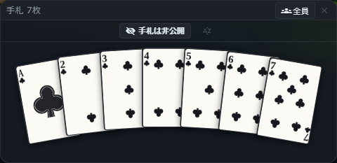

自分の手札です。公開しているかどうかと、誰から渡されたカードかが、カードの外に出ます。

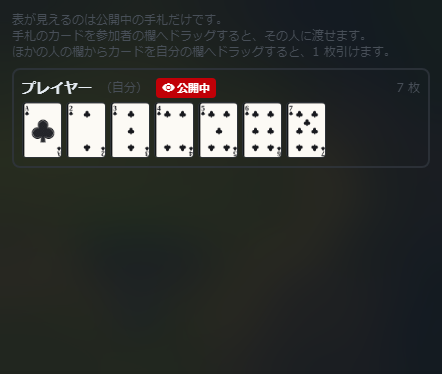

全員の手札です。公開中のカードは表、非公開のカードは裏が見えます。

## 短い言葉からスタンプを出す

**デモ（r10）で試せます**

スタンプに検索語を登録しておくと、チャットに短い言葉を打つだけで候補に出ます。絵文字だけの発言は大きく表示されます。スタンプのセットはZIPに保存できるので、別の部屋でも同じセットを使えます。

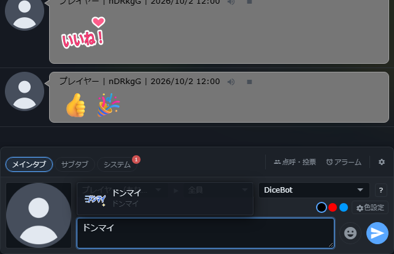

打った言葉に合うスタンプが、候補に出ます。

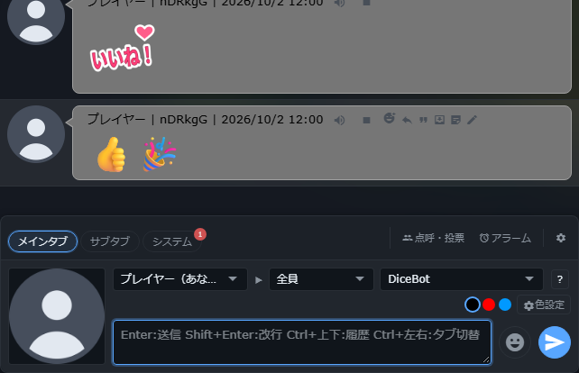

絵文字だけの発言は、大きく表示されます。

## チャットを読み上げる

**デモ（r10）で試せます**

新しい発言を、ブラウザの音声合成で読み上げます。声と速さは自分の端末で選べて、チャット欄のボタンですぐに入り切りできます。ルビの付いた言葉はふりがなで読みます。部屋のサーバーで回線が一瞬切れても、同じ部屋につなぎ直せば読み上げは止まりません。

## キャラクターの見た目を変える

**デモ（r10）で試せます**

キャラクターの画像に、左右反転・半透明・黒塗り・セピア・暗くする・赤く点滅・揺らす・オーラ（8色）を重ねられます。Udonarium with Flyを参考にした機能です。卓上のコマだけでなく、チャットのアイコン、立ち絵、ノベルモードの立ち絵とその履歴にも同じ効果が出ます。

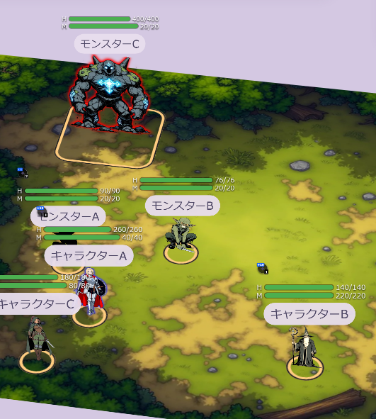

モンスターCに赤いオーラ、キャラクターBにセピア、モンスターBに左右反転を付けた卓です。

## 頭上のリソースを部屋でそろえる

**デモ（r10）で試せます**

コマの頭上に出すリソース（HPなど）を、GMが部屋設定で名前から選べます。コマを一つずつ設定し直さなくても、どのコマにも同じ項目が並びます。

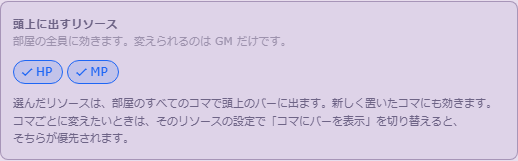

部屋設定で、頭上に出すリソースをHPとMPにしたところです。

## 一枚の絵から、部位ごとのコマ

**デモ（r10）で試せます**

画像の一部をドラッグで囲み、部位ごとに名前を付けてコマにします。HPやバフは部位ごとに持ち、位置・大きさ・向きはまとめて動かせます。発言するときは、全体の名前と元の画像で話すことも、部位を選んで話すこともできます。通常の卓データとして保存できます。

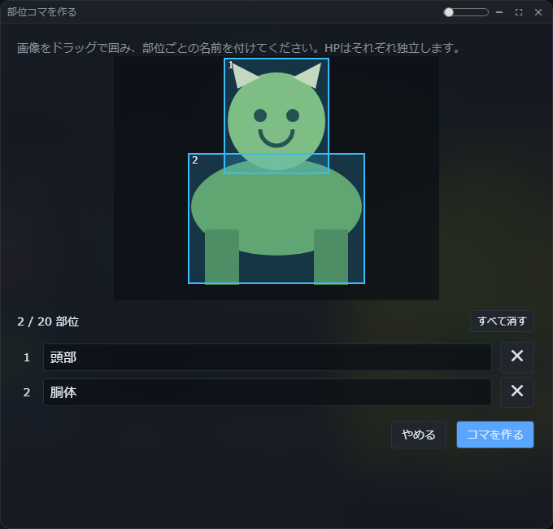

頭部と胴体を囲んで、別々のキャラクターコマにした例です。

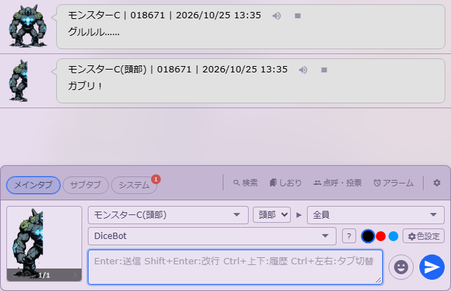

全体の名前で話したあと、部位を選んで「モンスターC(頭部)」として話しています。

## 小さな反応を、さっと送る

**デモ（r10）で試せます**

絵文字、短い文字、卓の画像を素材にした、反応用のエフェクトです。相手の上にぽんと出す、投げる、降らせるといった動きが短く再生されます。ホットバーにも登録できます。

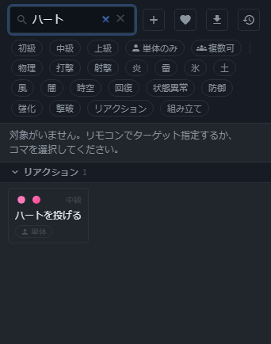

エフェクトの一覧から、反応の演出を選びます。

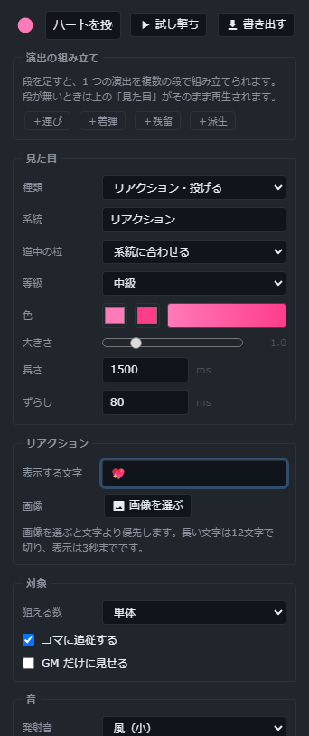

反応の素材と動きを編集します。

## ホットバーで、まとめて動かす

**デモ（r10）で試せます**

はじめてホットバーを開くと、1D100をチャットに入れる・キャラクターシートを開く・コマへ視点を移す、の3つの見本が入っています。マルチボタンは、登録した枠を順に動かすほか、スイッチと同じ動作（発言・秘話・効果音・演出・カットイン・表示の切り替えなど）を枠を使わずに並べられます。

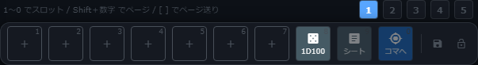

新しく使い始める人向けの、3つの見本です。

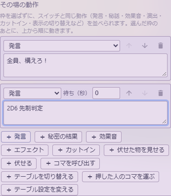

マルチボタンの「その場の動作」に、発言を2つ並べたところです。

## カットインの文字を一つずつ動かす

**デモ（r10）で試せます**

文章は一つのまま、文字ごとに、出てくる順番・間隔・方向・傾き・退場を選べます。入場は、ずれ・拡大・回転・透明度・ぼかし・緩急を自分で組み合わせられます。来た道を戻って消える退場や、ランダムな文字が正しい文字へ変わっていくデコーダーもあります。まずは見本ボタンから選べます。

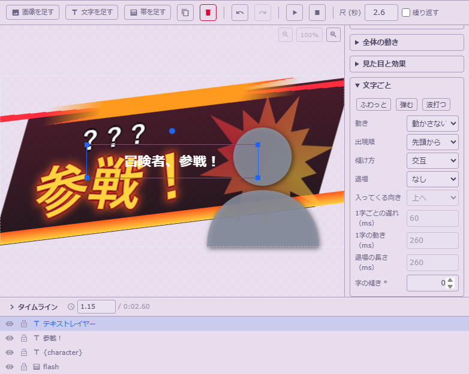

「文字ごと」を開くと、見本ボタンから動きを選べます。

## カットインに時計とタイマーを出す

**デモ（r10）で試せます**

カットインの文字に{time}と書くと現在の時刻、{remaining}で残り時間、{elapsed}で経過時間が出ます。{time:hh:mm:ss}、{remaining:mm:ss}、{elapsed:ss.00}のように、表示の形も選べます。休憩の案内や制限時間に使えます。

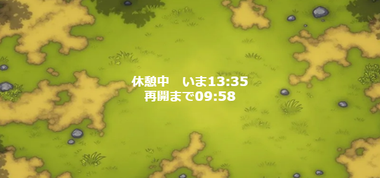

休憩のカットインに、いまの時刻と再開までの残り時間を出しています。

## 演出の見本を取り込む

**デモ（r10）で試せます**

短い演出の見本16個は、アプリには入れていません。使いたいときだけGitHubから16個入りのZIPをダウンロードして、いつもの読み込みで部屋に取り込みます。取り込んだ見本は、普通のカットインとして編集できます。

[16個入りの演出見本ZIPをダウンロード](https://github.com/synchro4351/udonarium_axe/raw/main/examples/tyoitashi-cut-ins.zip)

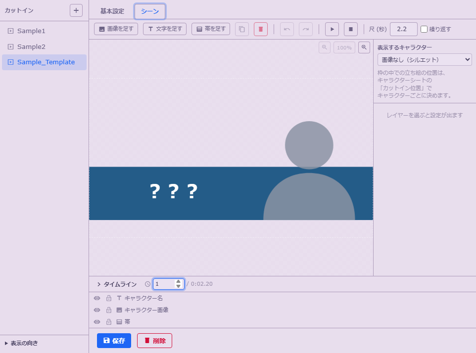

キャラクターの画像と名前を差し込むだけの、簡単なテンプレートです。

## ほかのちょい足し

**デモ（r10）で試せます**

ルビは`|漢字<かんじ>`と半角でも打てます。画像を追加するときは、スポイトで選んだ背景の色を透明にできます。整形表示は、共有メモのほかにキャラクターの長文・カード・マップマスクでも選べます。キャラクターはダブルクリックでシートが開き、メニューの設定ファイル（menus.json）は画面にドロップするだけで読み込めます。大きな画像は、追加するときに縮小してから共有します。

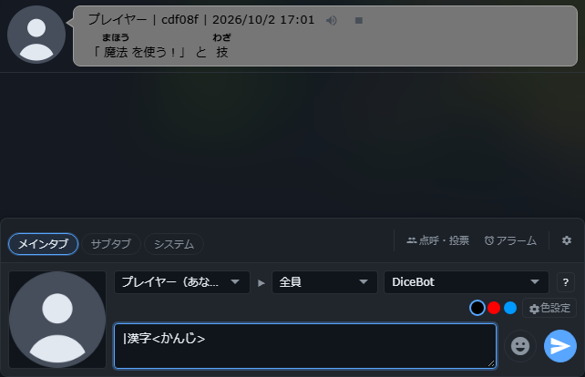

新しい書き方とこれまでの書き方を、同じチャットで使った例です。

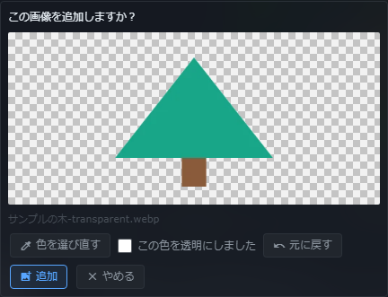

スポイトで背景の色を選び、透明になった結果を確かめます。

## 素材と利用条件

画面写真は動きを止めたものです。ソースと同梱素材の条件は、リポジトリの[LICENSE](https://github.com/synchro4351/udonarium_axe/blob/main/LICENSE)を見てください。くわしい確認結果は[開発者向け資料](DEVELOPER_REFERENCE.md)にあります。
